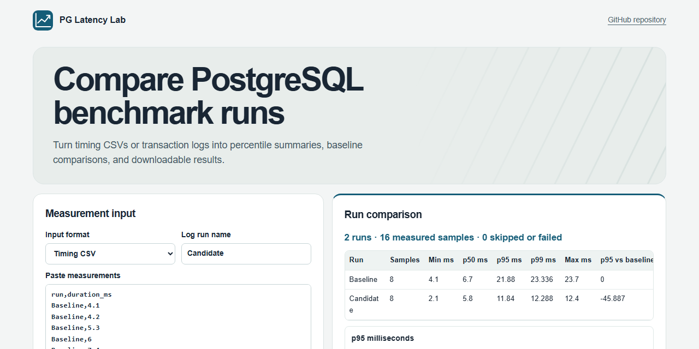

# PG Latency Lab

**Compare PostgreSQL benchmark runs.** Turn timing CSVs or transaction logs into percentile summaries, baseline comparisons, and downloadable results.

[Open the live tool](https://musabukhari237.github.io/pg-latency-lab/) · [Report an issue](https://github.com/MusaBukhari237/pg-latency-lab/issues)

[](https://musabukhari237.github.io/pg-latency-lab/)

## Try the example

Load the sample to compare baseline and candidate runs. Choose the candidate as baseline to reverse the comparison. Download the summary CSV.

## Data and limits

CSV input uses run,duration_ms. Paste a PostgreSQL pgbench -l transaction log for a single run. Aggregated logs are outside the supported format. Successful transaction times are converted from microseconds to milliseconds. Percentiles interpolate between sorted samples. Compare runs measured under the same workload.

See the [PostgreSQL per-transaction logging format](https://www.postgresql.org/docs/current/pgbench.html#PGBENCH-LOGGING). For a comparison spanning multiple pgbench logs, convert each transaction’s time to milliseconds and combine the runs in one CSV.

## Run locally

Clone the repo and serve the `docs` folder from localhost.

```sh
python -m http.server 8000 --bind 127.0.0.1 --directory docs
```

Open http://127.0.0.1:8000 in a current browser. Run `node --test` from the repository root with Node.js 22 or later.

## Sponsors

Supported by [LeadCeleris](https://www.leadceleris.com/) and [AIFFICIENTO](https://www.aifficiento.biz/).

## Contributing

Read [CONTRIBUTING.md](CONTRIBUTING.md) and use synthetic fixtures in issue reports. The source is available under the [MIT license](LICENSE).
